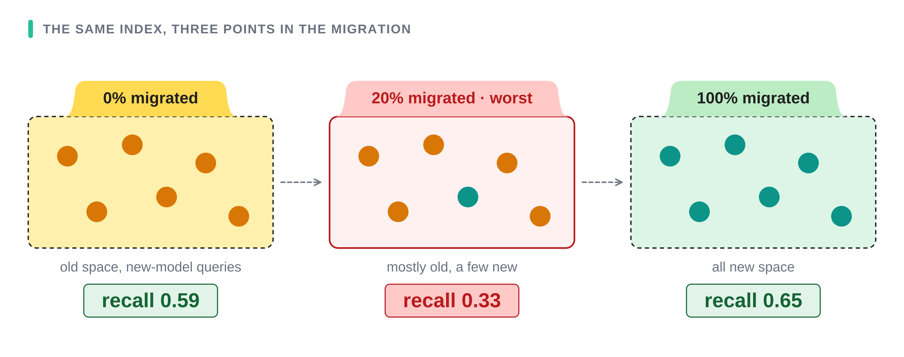
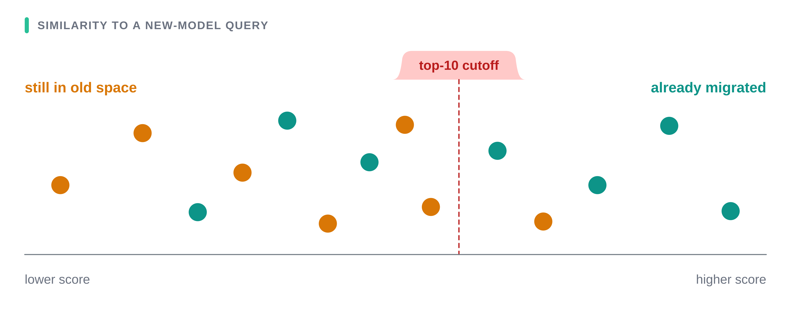

# What happens to recall while you migrate embedding models

[](LICENSE)
[](requirements.txt)
[](vespa/)
[](https://github.com/beir-cellar/beir)
[](results/)

> Migrate a vector index to a new embedding model a slice at a time and recall does
> not dip and recover. It falls **below both the index you started from and the one
> you finish with**, worst at about a fifth migrated.

Code and raw results for the experiments behind the article *Half-migrating your
embeddings is worse than either end*. Every number in that article is produced by a
script in here and recorded in `results/` or `vespa/results/`, per seed rather than
summarised, so any figure it quotes can be recomputed rather than taken on trust.



**Jump to:** [the finding](#the-finding) · [layout](#layout) · [setup](#setup) ·
[running it](#running) · [evaluation settings](#setup-used) ·
[reading the results](#reading-the-results) · [caveats](#caveats) ·
[the Vespa half](vespa/)

## The finding

On SciFact, with queries switched to the new model first, recall@10 fell **below both
the starting index and the finished one**, and bottomed out with less than a third of
the documents moved.

| Documents re-embedded | recall@10, raw | recall@10, normalized per space |
|---|---|---|
| 0% (queries already switched) | 0.59 | 0.59 |
| 10% | 0.35 | 0.59 |
| 20% | **0.33 (worst)** | 0.60 |
| 50% | 0.41 | 0.61 |
| 80% | 0.58 | 0.65 |
| 100% | 0.65 | 0.65 |

Mean of five random migration orders. Before anything moved, old queries against old
documents scored 0.78. The five seeds bottomed at 0.307–0.369, at 10% migrated once,
20% three times and 30% once, so the depth varies but every order dipped below both
ends.



Against a new-model query, migrated documents score higher on average, 0.146 against
0.081, so they take most of the top-10 slots: 84% at 10% migrated and 92% at 20%. The
two distributions overlap heavily, though, and 24.6% of old-space scores still beat
the median migrated one, so this is crowding out rather than a clean separation.

Two further results:

- **Per-space score normalization repairs it in exact search but not when retrieval
  runs through a fixed-size candidate list.** Exact search over every document
  recovers 0.33 to 0.60. On an HNSW graph updated in place, the same fix only reaches
  0.38, because by 20% migrated the graph returns just 40% of each query's relevant
  old-space documents, down from 79%, a figure that is a per-query mean here and
  pooled in the Vespa runs, so the two sit within a few hundredths of each other
  rather than being the same estimator. Normalization can only reorder what came back.
  Rebuilding the graph on the mix instead gives 0.39 and 42%, so the protocol barely
  matters. Widening the search fourfold (ef_search 200) lifts it to 0.48 and reach to
  75%, against a 91% baseline at that width, still short. The approximate graph is
  not the cause: the Vespa run in `vespa/` measures the same reach with exact search
  at the same candidate budget and gets 0.475 against the graph's 0.442, so almost
  all of the loss is migrated documents taking the candidate slots, which brute-force
  retrieval into a list of the same size would do too.
- **Switching queries last mirrors the problem rather than avoiding it.** The low
  point moves to 80% migrated for the close pair and 90% for the distant one, in
  all five orders either way, and still sits below both ends.

## Layout

```
scripts/     the five runs
results/     raw JSON written by each run
```

| Script | What it runs | Output |
|---|---|---|
| `stage2_cosine_separation.py` | Mean cosine of migrated vs un-migrated documents to a new-model query, and the share of top-10 slots migrated documents take, at every fraction | `stage2_cosine_results.json` |
| `stage3_hnsw_and_distant_pair.py` | The main run. Five seeds; HNSW in-place vs rebuilt-on-mix; a distant model pair; top-10 share | `stage3_results.json` |
| `stage5_queries_last.py` | The reverse order: documents migrate first, queries switch last | `stage5_results.json` |
| `stage6_fiqa.py` | Everything above repeated on FiQA, 57,638 documents | `fiqa_results.json` |
| `stage7_ef_search.py` | Does a wider graph search (ef_search 200) recover more than ef 50? | `stage7_ef_results.json` |
| `stage8_normalization_statistics.py` | Where the per-space statistics have to come from, and how little of each space they need | `stage8_normalization_statistics.json` |

The Vespa half of the repo is in `vespa/`, with its own README. It runs the same
migration in a real engine and holds the controls that separate what a second
embedding field does from what a wider candidate list does.

## Setup

```bash
python3 -m venv venv && source venv/bin/activate
pip install -r requirements.txt
```

`hnswlib` ships as a source distribution with no wheels, so this step needs a C++
toolchain. On a bare container, install build tools first.

## Running

Run stage 3 first. It embeds the documents and caches them as `emb_*.npy` next to the
scripts. That cache is gitignored, so a clean checkout embeds all of it, including the
distant-pair array the Vespa half's `prepare_embeddings.py` does not write. Stages 5 and 7 need that cache and stop with a clear message if it is missing;
stage 2 re-embeds on its own if it has to, which costs a few minutes. Set
`EMB_CACHE=/some/path` to keep the cache elsewhere.

```bash
python scripts/stage3_hnsw_and_distant_pair.py   # first run embeds 5,183 docs x3; ~10 min
python scripts/stage2_cosine_separation.py       # ~1 min once cached
python scripts/stage5_queries_last.py            # ~2 min once cached
python scripts/stage7_ef_search.py               # ~2 min once cached
python scripts/stage6_fiqa.py                    # 57,638 docs x3 models, 30-90 min
```

Paths are relative to each script, not to your shell, so it does not matter which
directory you run from. Every script writes its JSON into `scripts/`. The copies in
`results/` are the runs the article quotes, timed on an Apple M3 Pro, 11 cores, CPU
only; stage 6 pins hnswlib to 8 insert threads.

Stages 1 and 4 are not in the repo. Stage 1 was an exploratory first pass that stage 3
supersedes, and stage 4 was the linear map between the two spaces, dropped because it
was scored on the documents it was fitted on (see Caveats).

## Setup used

- **Datasets:** [BeIR/scifact](https://huggingface.co/datasets/BeIR/scifact) (5,183
  documents, 300 test queries) and [BeIR/fiqa](https://huggingface.co/datasets/BeIR/fiqa)
  (57,638 documents, 648 test queries)
- **Close model pair:**
  [all-MiniLM-L6-v2](https://huggingface.co/sentence-transformers/all-MiniLM-L6-v2) →
  [paraphrase-MiniLM-L6-v2](https://huggingface.co/sentence-transformers/paraphrase-MiniLM-L6-v2)
- **Distant model pair:** all-MiniLM-L6-v2 →
  [bge-small-en-v1.5](https://huggingface.co/BAAI/bge-small-en-v1.5)
- All three models are 384-dimensional, so the index width never changes
- **Metric:** recall@10, pooled across queries. Total relevant documents retrieved in
  the top 10 divided by total relevant documents, not the per-query mean, so queries
  with several relevant documents weigh more. Published BeIR numbers use the per-query
  mean, so do not compare these figures to a leaderboard directly.
- Cosine similarity throughout, vectors L2-normalized
- **Per-space normalization:** a per-query z-score. Within each space, subtract that
  space's mean similarity for the query and divide by its standard deviation, then take
  the top 10 over the combined scores. Exact search normalizes over all documents; a
  graph run can only normalize the candidates it returned, which is why it recovers less.
- **Graph:** [hnswlib](https://github.com/nmslib/hnswlib), M 16, ef_construction 200,
  ef_search 50 (and 200 in stage 7), tuned so the fully migrated graph matched exact
  recall within 2%. The candidate set a graph run scores is the `k = ef_search`
  neighbours it returns, so "reach" is relative to that width.
- **Seeds:** five migration orders, 0 through 4, eleven fractions from 0% to 100%.
  hnswlib is built with `random_seed=100`, and the FiQA neighbour-overlap sample uses
  `default_rng(0)`. Parallel inserts still make the graph runs non-deterministic; the
  size of that is in Caveats.

## Reading the results

Each JSON holds per-seed curves rather than summaries, so the means in the article can
be recomputed. For example, the raw SciFact curve:

```python
import json, numpy as np
d = json.load(open("results/stage3_results.json"))
np.round(np.mean(d["exact_curves_minilm"]["raw"], axis=0), 3)
# array([0.59 , 0.355, 0.33 , 0.342, 0.371, 0.413, 0.468, 0.527, 0.578, 0.612, 0.646])
```

Those eleven values are the 0%, 10%, ... 100% points. The article's table quotes six
of them.

`hnsw.protocols` holds `raw`, `norm` and `reach` for both build protocols;
`distant_pair` holds the second model pair; `fiqa_results.json` mirrors the same shape
with `qfirst_*` and `qlast_*` sections. Reach at 100% migrated is `null`, since no
old-space documents remain to reach.

Where the rest of the article's figures live:

- the 0.78 starting point, old queries against old documents:
  `stage5_results.json` → `baselines.oldq_vs_olddocs`
- the queries-last curves: `stage5_results.json` → `minilm_pair_exact`,
  `distant_pair_exact`, `minilm_pair_hnsw_inplace`
- the wider graph search: `stage7_ef_results.json` → `runs.ef50_*` and `runs.ef200_*`,
  each `A_inplace_update` and `B_rebuild_on_mix`, fractions 0% to 30% only
- the cosine separation, the top-10 share, and how far the two score distributions
  actually overlap: `stage2_cosine_results.json` → `whole_corpus`, which records the
  means, the standard deviations, and the share of old-space scores above the median
  migrated score (0.246). The means alone suggest two separated groups; they are not.

## Caveats

- On these benchmarks the model standing in for the "new" one is the weaker retriever.
  The experiment is about the shape of the migration window, not whether the upgrade
  is worth making.
- The low point appeared only where the query swap left some recall to lose. On FiQA
  the distant pair lost almost everything at the query swap alone, so the migration
  was a climb from near zero rather than a dip.
- Two model pairs, both 384-dimensional and both small. Nothing here says a 768- or
  3072-dimensional pair behaves the same way.
- Five seeds on 300 SciFact queries and 648 FiQA queries. The spread is reported above
  but there are no confidence intervals, and the per-seed depth varies by 0.06.
- Per-space normalization needs a model tag on every vector, a rescoring pass, and
  knowing which space each document is in. It was described here as an oracle fix,
  on the grounds that its statistics come from every document. Stage 8 shows that
  part is wrong: the statistics are two numbers per space, and 256 sampled documents
  per space land within 0.002 of using all of them (0.5947 against 0.5965). What the
  fix cannot do is cheap is recover a document the candidate list never held.
- The two halves of this repo do not normalize identically, and the difference is
  worth about 0.10. stage 3 scores a candidate list and can only take each space's
  mean and standard deviation from the candidates it returned; the Vespa rank profile
  receives them computed over every document. At a fixed 50-candidate budget that is
  0.4147 against 0.5156 (`stage8_normalization_statistics.json`), which is most of why
  the simulation reports 0.38 for the single-field case and Vespa reports 0.48.
- hnswlib inserts in parallel, so graph results are not bit-reproducible. Comparing the
  ef 50 runs in `stage3_results.json` and `stage7_ef_results.json`, which run identical
  code on identical embeddings, per-seed recall differs by up to 0.006 and reach by up
  to 0.016. One SciFact document is 1/339 = 0.003 of pooled recall, so that is a run-to-run
  gap of two documents.
- `ef_search` was picked on the evaluation queries themselves. Stages 3 and 6 take
  the first width whose fully migrated graph reaches 98% of exact recall on the same
  300 SciFact or 648 FiQA queries the results are scored on, which lands on 50. That
  tunes the graph in the index's favour, which only makes the low point harder to
  explain away, but it is not a held-out choice. Stages 5 and 7 then hardcode what
  that search selected, 50 in stage 5 and 50 and 200 in stage 7, rather than
  re-tuning.
- A linear map between the two spaces was tried and is not reported, because it was
  scored on the same documents it was fitted on.
- Neighbour overlap in `stage6_fiqa.py` is computed on a 3,000-document sample, not the
  full document set. The SciFact overlap figures the article quotes cover every document.
